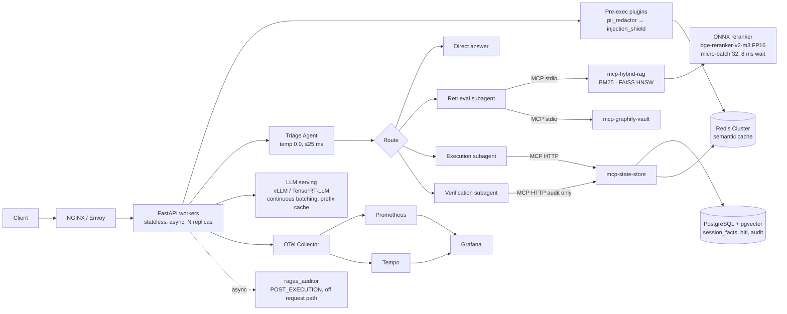

# design.md — "The Unreliable Assistant" → Enterprise Agentic Platform

Status: **LOCKED (2026-11-18) with the defaults recorded in Section 9.** The owner chose to lock with the Proposed defaults. Items not answered are marked "default adopted" and can be reopened through a new ADR (Section "Definition of locked").
Sources: `Unreliable_Assistant_MidCheck_Enterprise_Blueprint_v2.docx` (spec, "Blueprint") and `Post_Hardening_Engineering_Audit_Report.docx` (claimed results, "Audit"). Where they conflict, the resolution is recorded in Section 8. The governing rules and deviation register are in `CLAUDE.md`.

---

## 1.1 System Charter & Hard Boundaries

### Purpose
An MCP-enabled, plugin-extensible agentic assistant that answers enterprise questions from a governed knowledge base, performs tenant-scoped read and write actions through tools, and sustains 50,000 concurrent virtual users (VUs) at p95 ≤ 450 ms and p99 ≤ 590 ms (KPI-33).

### In scope
- Grounded Q&A over enterprise policies, SOPs, and product catalogs (hybrid RAG).
- Tool-mediated lookups (read tier) and workflow transitions / form submissions (mutate tier, HITL-gated).
- Multi-tenant operation with strict isolation of data, cache, and audit records.
- Observability, red-team, and load-test harnesses as first-class deliverables.

### Non-goals (hard boundaries)
1. **No autonomous clinical, financial, or legal execution.** Any Tier 3 (mutating) action in these domains requires a human approval record before execution.
2. **No Tier 3 action without a `PENDING_APPROVAL` → approved transition.** No bypass flag exists.
3. **No raw PII persistence.** Redacted text only reaches logs, cache, and LLM prompts.
4. **No open web access** from the Execution or Retrieval subagents.
5. **No unbounded agent loops.** Every request terminates in `DONE` or `HALTED_*`.
6. **Not a general chat product.** Out-of-scope queries get `REJECT_OOS`.

### User personas
| Persona | Needs | Primary surface |
|---|---|---|
| End user (employee/customer) | Grounded, cited answers; quick responses | `POST /api/v1/agent/query` |
| Approver / reviewer | Approve or reject Tier 3 actions | HITL queue (API + Streamlit Tab 1) |
| Operator / SRE | Health, breakers, runbooks, traces | Grafana, Streamlit Tabs 3, 5, 6 |
| Compliance auditor | Tamper-evident audit trail, tenant evidence | Audit log export, `session_facts` |
| Knowledge owner | Keep policies current and linked | Obsidian vault (`knowledge_vault/`) |
| Developer | Build, test, and verify against the KPIs | CI, Streamlit Tabs 2, 4 |

---

## 1.2 MCP Tool & Data Contracts

All tool traffic is MCP JSON-RPC 2.0. Local workers use stdio; distributed services use Streamable HTTP. Every call passes through `ToolExecutionHarness` (Section 1.2.4).

### 1.2.1 Server inventory
| Server | Transport | Tools | Resources | Tier ceiling |
|---|---|---|---|---|
| `mcp-hybrid-rag` | stdio (long-lived process, not spawned per call) | `hybrid_retrieve` | `rag://chunks/{chunk_id}` | TIER_1_READ |
| `mcp-graphify-vault` | stdio (long-lived) | `graph_subgraph` | `vault://notes/{note_id}` | TIER_1_READ |
| `mcp-state-store` | Streamable HTTP, pool_size 200 | `session_facts_get`, `session_facts_put`, `workflow_transition`, `hitl_request`, `hitl_decide`, `audit_append` | — | TIER_3_MUTATE (only via harness-approved calls) |

### 1.2.2 Tool schemas (Pydantic v2 models; JSON Schema is generated from these)

**`hybrid_retrieve` — input**
```json
{
  "type": "object",
  "required": ["request_id", "tenant_id", "query"],
  "additionalProperties": false,
  "properties": {
    "request_id": {"type": "string", "format": "uuid", "description": "UUIDv4"},
    "tenant_id":  {"type": "string", "pattern": "^tenant_[a-z0-9_-]{1,56}$"},
    "query":      {"type": "string", "minLength": 3, "maxLength": 512},
    "top_k":      {"type": "integer", "minimum": 1, "maximum": 50, "default": 50},
    "rerank_k":   {"type": "integer", "minimum": 1, "maximum": 4, "default": 4},
    "threshold":  {"type": "number", "minimum": 0, "maximum": 1, "default": 0.42}
  }
}
```

**`hybrid_retrieve` — output**
```json
{
  "type": "object",
  "required": ["abstain", "chunks", "stage_ms"],
  "properties": {
    "abstain": {"type": "boolean"},
    "chunks": {"type": "array", "maxItems": 4, "items": {
      "type": "object",
      "required": ["chunk_id", "chunk_hash", "text", "bm25", "cosine", "rrf_rank", "rerank_score"],
      "properties": {
        "chunk_id": {"type": "string", "pattern": "^[a-z0-9_-]{1,128}$"},
        "chunk_hash": {"type": "string", "pattern": "^[a-f0-9]{64}$"},
        "text": {"type": "string", "maxLength": 4096},
        "bm25": {"type": "number"}, "cosine": {"type": "number"},
        "rrf_rank": {"type": "integer", "minimum": 1, "maximum": 40},
        "rerank_score": {"type": "number", "minimum": 0, "maximum": 1}
      }}},
    "stage_ms": {"type": "object", "properties": {
      "bm25": {"type": "number"}, "biencoder": {"type": "number"},
      "rrf": {"type": "number"}, "rerank": {"type": "number"}}}
  }
}
```

**`graph_subgraph` — input:** `{ "anchor_id": "^[A-Z]{2,4}-[0-9]{3,6}$|^note_[a-z0-9_-]+$", "depth": 0..2 (max 2), "max_tokens": 1..320 }`. Output: `{ "nodes": [...], "edges": [...], "token_estimate": int }`.

**`session_facts_put` — input:** `{ "request_id": UUIDv4, "tenant_id": tenant regex, "session_id": UUIDv4, "fact_key": "^[a-z_]{3,64}$", "fact_value": string (≤ 1024 chars), "source_chunk_hash": sha256 hex }`. Writes only verified facts (see Gate 5).

**`workflow_transition` / `hitl_request` — input (Tier 3):** `{ "request_id": UUIDv4, "idempotency_key": UUIDv4, "tenant_id": tenant regex, "action": "^[a-z_]{3,48}$", "args": object (validated per action), "risk_tier": "TIER_3_MUTATE" }`. A Tier 3 call with no matching approved `hitl_decide` record is rejected with `E_HITL_PENDING` (-32004).

**Entity formats (used by auto-repair):**
- SKU: `^SKU-[0-9]{3}$` (e.g., `SKU-099`). Repair: `SKU99` → `SKU-099`.
- LOT: `^LOT-[0-9]{5}$`. Repair: `lot 44` → `LOT-00044`.
- Tenant: `^tenant_[a-z0-9_-]{1,56}$`.

### 1.2.3 Error codes (JSON-RPC)
| Code | Name | Meaning | Client action |
|---|---|---|---|
| -32600 | `E_INVALID_REQUEST` | Malformed JSON-RPC envelope | Fix client |
| -32602 | `E_VALIDATION` | Schema violation not repairable | Return structured remediation prompt |
| -32001 | `E_TENANT_FORBIDDEN` | `tenant_id` mismatch with session / token | Deny; log security event |
| -32002 | `E_TIMEOUT` | Per-step or MCP timeout exceeded | Retry only if budget remains |
| -32003 | `E_BREAKER_OPEN` | `(tool_name, canonical_args_hash)` breaker tripped | Show remediation; do not retry |
| -32004 | `E_HITL_PENDING` | Tier 3 action awaiting approval | Show pending status |
| -32005 | `E_RBAC_DENIED` | Tier ceiling exceeded for this subagent | Deny |
| -32006 | `E_IDEMPOTENT_REPLAY` | Same `idempotency_key`, different args | Deny; log |
| -32007 | `E_DEGRADED` | Dependency down; fallback served | Serve fallback; flag response |

### 1.2.4 ToolExecutionHarness (every MCP call, in order)
1. **Strict validation**: Pydantic v2 `strict=True`, `extra="forbid"`.
2. **Deterministic auto-repair** (regex rules only; no LLM in repair). At most one repair pass. Repaired values are logged with the original value.
3. **RBAC tier check**: `TIER_1_READ` / `TIER_2_COMPUTE` / `TIER_3_MUTATE` against the calling subagent's ceiling (Section 1.2.1 and Gate 7).
4. **Idempotency**: `UUIDv4 idempotency_key` required on every mutating call; replay with identical args returns the stored result; replay with different args → `E_IDEMPOTENT_REPLAY`.

**Tier definitions:** `TIER_2_COMPUTE` is named in the Blueprint (Gate 4) but no tool uses it and no source defines it. Open item (C24, Section 9).

**Public API contract (proposed, inferred from the k6 and JMeter plans):** `POST /api/v1/agent/query` takes a JSON body `{tenant_id, user_id, query}` and header `X-Tenant-ID`. The response must include `tenant_id` and `faithfulness`. Authentication and authorization are not specified anywhere; the tenant must come from verified credentials. See Section 9.

---

## 1.3 Distributed Topology & Data Flow



**Rules**
- API workers hold no session state; all state is in Redis or Postgres.
- Each MCP server runs in its own bulkhead pool (Sections 1.6 and 1.9): `rag_pool=64`, `db_pool=128`, `llm_pool=256` per replica.
- RAGAS scoring and OTel export are **asynchronous** and off the request path. Section 1.4 depends on this. **This is not confirmed by the sources** (C21, Section 9).
- The Verification subagent's NLI check is shown on the request path (VERIFY state). Its latency is not in the Section 1.4 budget (X1).
- The Gate 1.3 diagram must show the API gateway, Redis cache, MCP servers, ONNX reranker, and PostgreSQL. The diagram above does.

---

## 1.4 End-to-End Latency Budget (p95 ≤ 450 ms, p99 ≤ 590 ms)

### Nominal path (HYBRID_RAG, the heaviest route)
| # | Hop | p95 budget (ms) | Basis |
|---|---|---:|---|
| 1 | Ingress: gateway, TLS, auth, JSON parse | 10 | Assumption |
| 2 | `hook.pre` (PII + injection) | 15 | KPI-01 |
| 3 | `cache.lookup` (Redis) | 2 | Blueprint ("sub-ms") |
| 4 | `triage.classify` | 25 | KPI-05 |
| 5 | `rag.bm25` | 12 | KPI-07 |
| 6 | `rag.dense` (FAISS HNSW) | 25 | KPI-08 |
| 7 | `rag.rrf` | 3 | Gate 3 |
| 8 | `rag.rerank` | 45 | KPI-09 |
| 9 | MCP serialization, 3 calls × 4 ms | 12 | KPI-30 |
| 10 | `graph_subgraph` (≤ 320 tokens) | 15 | Assumption |
| 11 | `session_facts` read | 5 | Assumption |
| 12 | `llm.generate` (TTFT ≤ 180 ms + stream) | 250 | KPI-25 (TTFT); 250 total is an assumption |
| 13 | Egress: serialize and send | 10 | Assumption |
| | **Nominal total** | **429** | Margin to 450: **21 ms** |

Items 5–12 form the **bounded loop**. Nominal loop time is 367 ms. The loop ceiling is **380 ms** (ADR-04, proposed; Blueprint value is 450 ms, C5). Worst case with 380 ms: 10 + 15 + 2 + 25 + 380 + 10 = **442 ms**, under 450. With the Blueprint's 450 ms it would be 512 ms, over the gate.

**Not yet shown:** a Verification (NLI) hop and a synchronous RAGAS hop, if either is on the request path (X1). Per-hop p95s are shown, but **p99 is not demonstrated** (Gate 1.4 asks for it). Summing p95s gives a conservative p95 bound only.

### Other routes
| Route | Nominal p95 | Note |
|---|---:|---|
| `DIRECT_ANSWER` | ~ 60 ms + LLM | No retrieval hops |
| `HYBRID_RAG`, abstention (rerank top score < 0.42) | ≤ 160 ms | Deterministic response in < 90 ms (Gate 9.3); clock start undefined (X3) |
| `TRANSACTION_EXEC` | Read path + HITL | Pending HITL is not a latency failure; it returns `E_HITL_PENDING` |
| `REJECT_OOS` | ≤ 40 ms | No LLM call |

### Latency rules that make the budget hold
- RAGAS scoring and OTel export run asynchronously (only if C21 confirms this).
- The LLM step has its own 250 ms timeout (C6, proposed). The 120 ms `per_step_timeout` [BP] applies to tool calls only.
- BM25 and the bi-encoder may run in parallel to save up to 12 ms. This is allowed; the budget does not assume it.
- **Capacity check (Little's law):** at 8,500 RPS and a 35% cache hit ratio, about 5,525 requests/s reach the LLM. At 250 ms each, that needs roughly **1,380 generations in flight fleet-wide**. This depends on the request rate, which the k6 plan implies is about 40,000 RPS (X6). Unverified.

---

## 1.5 KPI & SLA Gate Matrix (36 stage-level KPIs)

All KPIs are CI-blocking. Thresholds are hard pass/fail. The measurement source is named in the Blueprint (Gate 12). Span names in "Measured by" use the Gate 10 names (Section 8, C18).

| ID | Stage | KPI | Threshold | Measured by |
|---|---|---|---|---|
| KPI-01 | Ingress & Triage | Pre-hook guardrail latency (p95) | ≤ 15 ms | OTel `hook.pre` |
| KPI-02 | Ingress & Triage | PII redaction recall (email/phone/SSN/obfuscated) | ≥ 99.8% | Presidio + regex audit |
| KPI-03 | Ingress & Triage | Prompt-injection block rate (direct + indirect) | ≥ 99.5% | Red-team benchmark |
| KPI-04 | Ingress & Triage | Triage routing accuracy | ≥ 97.0% | Labeled intent set |
| KPI-05 | Ingress & Triage | Triage classification latency (p95) | ≤ 25 ms | OTel `triage.classify` |
| KPI-06 | Ingress & Triage | False-positive refusal on benign queries | ≤ 1.0% | Benign control set |
| KPI-07 | Hybrid Retrieval | BM25 latency (p95) | ≤ 12 ms | OTel `mcp.rag.bm25` |
| KPI-08 | Hybrid Retrieval | Bi-encoder + FAISS latency (p95) | ≤ 25 ms | OTel `mcp.rag.biencoder` |
| KPI-09 | Hybrid Retrieval | Cross-encoder rerank latency (p95) | ≤ 45 ms | OTel `mcp.rag.rerank` |
| KPI-10 | Hybrid Retrieval | Hybrid context recall @50 | ≥ 0.92 | RAGAS / IR eval |
| KPI-11 | Hybrid Retrieval | Post-rerank context precision @4 | ≥ 0.88 | RAGAS |
| KPI-12 | Hybrid Retrieval | MRR@4 | ≥ 0.85 | IR benchmark script |
| KPI-13 | Hybrid Retrieval | nDCG@4 | ≥ 0.86 | IR benchmark script |
| KPI-14 | Agent & Loop | Tool schema first-pass validation rate | ≥ 96.0% | Pydantic telemetry |
| KPI-15 | Agent & Loop | Auto-repair success on malformed args | ≥ 90.0% | Harness metrics |
| KPI-16 | Agent & Loop | Infinite-loop escape rate | 100.0% | Chaos loop suite |
| KPI-17 | Agent & Loop | Mean ReAct steps per completed task | ≤ 2.2 | OTel trace count |
| KPI-18 | Agent & Loop | Context drift score (goal cosine alignment) | ≥ 0.85 | Embedding drift audit |
| KPI-19 | Agent & Loop | Tier 3 HITL gate enforcement | 100.0% | Audit log integrity |
| KPI-20 | Generation & RAGAS | RAGAS faithfulness | ≥ 0.92 | Post-hook RAGAS |
| KPI-21 | Generation & RAGAS | RAGAS answer relevancy | ≥ 0.90 | Post-hook RAGAS |
| KPI-22 | Generation & RAGAS | RAGAS context entity recall | ≥ 0.85 | Post-hook RAGAS |
| KPI-23 | Generation & RAGAS | Unanswerable-query abstention accuracy | ≥ 98.0% | Negative test set |
| KPI-24 | Generation & RAGAS | Unsupported-claim / hallucination rate | ≤ 0.5% | NLI claim verifier |
| KPI-25 | Generation & RAGAS | Time-to-first-token (p95) | ≤ 180 ms | FastAPI stream metric |
| KPI-26 | Token & Graphify | Prompt token reduction (Graphify + Obsidian) | ≥ 45.0% | Token counter hook |
| KPI-27 | Token & Graphify | Semantic cache hit ratio (steady state) | ≥ 35.0% | Redis hit/miss metric |
| KPI-28 | Token & Graphify | Cross-tenant cache isolation | 100.0% (0 leaks) | Concurrency probe |
| KPI-29 | Token & Graphify | Cost per 1,000 queries | ≤ $0.45 | OTel token-cost calc |
| KPI-30 | Token & Graphify | MCP JSON-RPC serialization overhead (p95) | ≤ 4 ms | MCP client timer |
| KPI-31 | Scale & Load | E2E latency p50 @ 50K VUs | ≤ 240 ms | k6 + JMeter |
| KPI-32 | Scale & Load | E2E latency p95 @ 50K VUs | ≤ 450 ms | k6 + JMeter |
| KPI-33 | Scale & Load | E2E latency p99 @ 50K VUs | ≤ 590 ms (< 600 ms Blueprint wording) | k6 + JMeter |
| KPI-34 | Scale & Load | HTTP 5xx rate @ 50K VUs | ≤ 0.05% | k6 / JMeter |
| KPI-35 | Scale & Load | Sustained throughput | ≥ 8,500 RPS | k6 / JMeter |
| KPI-36 | Scale & Load | RSS growth over 1-hour soak | ≤ 3.0% | Prometheus node exporter |

**Note on "200–600 ms":** the Blueprint's target is a range. The enforced gates are p50 ≤ 240, p95 ≤ 450, p99 ≤ 590. The 200 ms lower bound is not checked.

**Owners:** none assigned yet (locking criterion).

### Audit claims vs. this design
The Audit reports measured results. This repository contains no code, load-test output, or dashboards, so **none of its numbers are verified here**. Treat them as claims until the artifacts are attached.

| Claim in Audit | Gate it must meet | Status |
|---|---|---|
| p95 390 ms, p99 540 ms | KPI-32/33 | Unverified. Non-LLM hops of the HYBRID_RAG path sum to 179 ms, so p50 185 ms implies mostly cache hits, direct answers, or abstentions. No route mix given |
| 9,240 RPS at 50K VUs | KPI-35 | Unverified. Implies ~5.4 s per iteration, inconsistent with k6's `sleep(1)` (X6) |
| RAGAS triad 0.94 / 0.91 / 0.89 (Faithfulness / Precision / Recall) | Faithfulness ≥ 0.92, Precision ≥ 0.88, Recall ≥ 0.85 (Gate 3 release gates) | Unverified. The triad is not KPI-20/21/22: KPI-21 is answer relevancy and KPI-22 is context entity recall, which the Audit does not report |
| 99.9% PII / adversarial block | KPI-02 / 03 | Unverified. 100 prompts cannot show 99.9% (X11) |
| 1,320 tokens / 1K queries ($0.38) | KPI-26 / 29 | Unverified; measured reduction ≈ 53.7% (Audit says 52.4%). Cost drop ≈ 89% exceeds token drop (X7) |
| "All 36 KPIs passed" | All | The Audit's table shows six metric rows; the rest have no numbers |
| "Zero security breaches" | — | No evidence attached |

---

## 1.6 Failure Mode & Effects Analysis (FMEA, 12 rows)

| # | Component failure | Detection | Deterministic fallback | Residual risk |
|---|---|---|---|---|
| 1 | **Redis down / timeout** | `cache.lookup` > 2 ms or connection error | Bypass cache; continue to triage. Emit `cache_degraded`. Tenant isolation holds because no shared key is read | Latency + LLM cost up |
| 2 | **`mcp-hybrid-rag` crash or hang** (JSON-RPC > 150 ms, > 1% rate) | Timeout counter | Trip bulkhead circuit; fail over to cached read-replica index; restart worker. If none: abstain with `E_DEGRADED` | Stale index |
| 3 | **Reranker timeout** (> 45 ms) | Stage timer | Return RRF top-4 flagged `rerank_unavailable`; enforce extractive-quote mode; no abstention short-circuit | Hallucination risk up; quote mode limits it |
| 4 | **FAISS index missing or corrupt** | Load-time check at worker start | Disable stage 2; BM25-only; flag `dense_unavailable`; alert | Recall drop (KPI-10 fails in degraded mode) |
| 5 | **`mcp-state-store` down** | Health check; HTTP error | Read-only degraded mode: no `session_facts` write, **all Tier 3 rejected (fail closed)** | Session context lost for the window |
| 6 | **`mcp-graphify-vault` down** | Timeout | Skip pruning; inject raw top-4 chunks (≈ 1,400 tokens vs. 320) | Token cost up; KPI-26 fails in this state |
| 7 | **LLM 429** | HTTP 429 | One retry with jittered backoff only if loop budget remains ≥ 150 ms; else return extractive answer from top chunk, `E_DEGRADED` | Lower answer quality |
| 8 | **LLM stall / timeout** (> 250 ms step) | Step timer | Cancel stream; return extractive answer; record `llm_timeout` | Partial answer risk; flagged |
| 9 | **Triage misroute** | Confidence below threshold | Default to `HYBRID_RAG` (read-only). **Never default to `TRANSACTION_EXEC`** | Unneeded retrieval latency |
| 10 | **PII redactor or injection shield exception** | Plugin exception | **Fail closed**: reject request with 503 and `Retry-After` | Availability loss, by design |
| 11 | **Postgres unavailable during HITL write** | `hitl_request` error | Reject the Tier 3 action; no partial write; no execution | User must retry |
| 12 | **OTel collector down** | Exporter error | Bounded in-memory queue; drop oldest spans; never block the request | Gaps in traces (counted) |

---

## 1.7 Architecture Decision Records (ADRs)

### ADR-01 — Hybrid retrieval: RRF over weighted-score fusion
- **Decision:** Fuse BM25 (k1 = 1.25, b = 0.75, top_k = 50) and dense (bge-large-en-v1.5, 512-token chunks, 64 overlap, FAISS HNSW efSearch = 64) with Reciprocal Rank Fusion (k = 60), dedup by `chunk_hash`, pool = 40. Rerank to top 4 with the cross-encoder, threshold 0.42.
- **Why:** BM25 and cosine scores are on different scales, so weighted sums need per-query normalization and an extra tuned weight. RRF uses ranks only and has one parameter.
- **Consequence:** No fusion weight exists to tune. The `RRF k` slider in Streamlit Tab 2 is the only fusion knob.
- **Alternatives rejected:** Weighted sum (scale-sensitive); dense-only (keyword blindness on SKU/LOT codes, the documented 38.6% hallucination cause).

### ADR-02 — ONNX FP16 for the reranker; INT8 only on evidence
- **Decision:** Ship `bge-reranker-v2-m3` in FP16, batch 32, `max_len` 512, micro-batch wait 8 ms.
- **Why:** FP16 preserves ranking quality. The Blueprint mentions both FP16 and INT8 (sub-35 ms).
- **Condition for INT8:** Only if KPI-09 (≤ 45 ms) fails, and only if RAGAS faithfulness (KPI-20 ≥ 0.92) and KPI-11 still pass after quantization.

### ADR-03 — Redis key isolation (SHA-256 of tenant, user, and normalized query)
- **Decision:** Key = `SHA256(tenant_id ":" user_id ":" norm_query)`, prefix-enforced, with TTL 300 s ± 45 s jitter.
- **Why:** Blueprint-mandated. No cross-user cache reads, which removes the cross-user leak class.
- **`norm_query` is undefined** in both sources. Suggested default: Unicode NFKC fold, case-fold, whitespace collapse (C25, Section 9).
- **Trade-off (open):** per-user keys mean KPI-27 (≥ 35% hit ratio) is only reachable through repeat queries by the same user. A tenant-scoped key with a per-user ACL check on cached responses would raise hits, at the cost of relying on that ACL. **Decision required (Section 9).**
- **"Semantic" cache (X2):** an exact SHA-256 key cannot do cosine matching. The Gate 11 mitigation says "cosine ≥ 0.92". Choose between an exact-match cache (rename it) or a vector cache (budget the embedding).

### ADR-04 — Bounded ReAct loops
- **Decision:** State machine `INIT → TRIAGE → REASONING → TOOL_CALL → OBSERVATION → VERIFY → DONE | HALTED_*`. `max_iterations = 5`. `per_step_timeout = 120 ms` (tool calls). LLM step timeout = 250 ms (C6, proposed). **`total_loop_budget = 380 ms`** (proposed; Blueprint says 450 ms, C5). No recursive self-call without a state mutation.
- **Why:** The Blueprint's 450 ms loop plus 35 ms ingress and guard plus egress exceeds the 450 ms p95 gate. The 380 ms ceiling keeps the worst case at 442 ms.
- **Circuit breaker:** trips when `(tool_name, canonical_args_hash)` fails ≥ 2 times. Transitions to `HALTED_BREAKER` with a remediation prompt. **Scope is open** (C20, Section 9).

---

### ADR-05 — LLM transport: OpenRouter, with Anthropic models (supersedes §9 item 13 transport choice)
- **Decision:** The primary LLM client calls the OpenRouter chat endpoint with model `anthropic/claude-sonnet-5.5` (the OpenRouter ID for Claude Sonnet 5.5, confirmed against the model list). The Anthropic SDK adapter stays available as a second provider.
- **Why:** The owner supplied an OpenRouter key, and no Anthropic key has been supplied.
- **Constraints:** Keys come from the environment only and are never stored in the repo or logged. Errors carry only the HTTP status, never the request. Temperature is 0.0 for triage and generation.
- **Consequence:** Cost per query must still meet KPI-29 (≤ $0.45 per 1,000 queries). This has not been measured yet.

## 1.8 Plugin & Lifecycle Configuration (from `mcp_config.json`)

- `pii_redactor` — PRE_EXECUTION, priority 10, **fail_closed: true**
- `injection_shield` — PRE_EXECUTION, priority 20, **fail_closed: true**
- `circuit_breaker` — TOOL_DISPATCH, priority 10, `max_identical_calls: 2`
- `ragas_auditor` — POST_EXECUTION, priority 10, `min_faithfulness: 0.92`, **async** (pending C21)
- `otel_exporter` — ALL_SPANS, endpoint `http://localhost:4317` (dev only; production uses the configured collector address)
- **HITL gate:** the Blueprint's Gate 0 plugin list includes "HITL Plugins", but no HITL entry exists in the Blueprint's `mcp_config.json`. Add a `hitl_gate` entry, or document that the gate is built in (C26, Section 9).

Plugins are pluggy/entry-point hooks. They are hot-swappable only when a new version passes the plugin contract tests. Disabling `pii_redactor` or `injection_shield` at runtime is not permitted in production. Streamlit Tab 3 shows these as locked in production; toggles are allowed in the dev workbench only (C22, proposed).

---

## 1.9 Agents & Routing (Gates 6, 7, 9)

### Triage Agent
- `temperature = 0.0`, distilled classifier, ≤ 25 ms p95 (C2).
- Output: `{intent, domain, risk_tier, complexity}` → one of `DIRECT_ANSWER`, `HYBRID_RAG`, `TRANSACTION_EXEC`, `REJECT_OOS`.
- Low confidence → `HYBRID_RAG`. It never routes to `TRANSACTION_EXEC` without high confidence and a Tier 3 classification.
- Triage classifier model and training data: not specified by either source (Section 9).

### Subagents
| Subagent | Responsibility | MCP servers | Guardrail |
|---|---|---|---|
| Retrieval | Query rewrite, 3-stage hybrid RAG, citations | `mcp-hybrid-rag`, `mcp-graphify-vault` | Read-only; cannot call mutating tools |
| Execution | Schema validation, form submission, workflow transitions | `mcp-state-store` | No RAG or web; Tier 3 triggers HITL freeze |
| Verification | Claim-to-chunk NLI check, RAGAS triad, OTel log | `mcp-state-store` (audit append only) | Independent context; can veto ungrounded drafts |

The Blueprint's Gate 2 diagram calls the fourth triage branch "Audit Subagent". It is treated here as the **Verification** subagent (C7). This is an assumption: the four triage labels do not map onto the four Gate 2 boxes, and the Audit report corroborates the name "Verification" (C23).

### Reliability patterns (Gate 9)
- **Bulkhead:** `rag_pool=64`, `db_pool=128`, `llm_pool=256`, isolated per MCP server, so a slow reranker never blocks health checks or triage.
- **Deterministic abstention:** rerank top score < 0.42 → fixed abstention response in < 90 ms, with no LLM call. Clock start for the 90 ms figure is open (X3).
- **Async HITL:** Tier 3 writes `PENDING_APPROVAL` to Postgres and pauses until an authorized reviewer decides through UI or API.

### Context retention (Gate 5)
1. **`GoalAnchorBlock`** (immutable): original intent, normalized entity IDs, active policy constraints. Placed at index 0 of every ReAct prompt.
2. **Observation compression**: strip boilerplate JSON keys; truncate each observation to ≤ 180 tokens.
3. **Sliding window**: last 3 ReAct turns in hot memory; verified facts persisted to Postgres `session_facts` keyed by `session_id`.

---

## 1.10 Observability (Gate 10)

- W3C `traceparent` on every hop. Spans: `hook.pre`, `cache.lookup`, `triage.classify`, `mcp.rag.bm25`, `mcp.rag.biencoder`, `mcp.rag.rrf`, `mcp.rag.rerank`, `agent.react.step`, `llm.generate`, `hook.post.ragas`.
- Pipeline: OTel Collector → Prometheus + Tempo → Grafana.
- Span aliases used in Gate 12 and the Audit (`triage`, `rag.bm25`, `rag.dense`, `rag.rerank`, `ragas`) map to the Gate 10 names (C18, Section 8).
- Alert thresholds: the Blueprint's runbook triggers at p95 > 550 ms for 30 s. **Proposed** (C8): warn at p95 > 400 ms for 60 s, page at p95 > 450 ms for 60 s. The Blueprint's 550 ms trigger sits above the SLA and fires too late.

### Incident runbook (Gate 11)
| Scenario | Alert | Mitigation |
|---|---|---|
| Latency breach | p95 > 550 ms for 30 s (Blueprint); proposed: > 450 ms for 60 s | Raise cache threshold to cosine ≥ 0.92; drop BM25 / dense `top_k` 50 → 25 |
| Hallucination surge | RAGAS faithfulness < 0.90 (5 min window) | Raise rerank cutoff 0.42 → 0.55; strict extractive-quote mode |
| MCP server hang | JSON-RPC timeout > 150 ms, > 1% | Trip bulkhead; failover to read-replica index; restart worker |
| Cache leak / stampede | Tenant key collision or Redis CPU > 85% | Enforce key prefix; jittered TTL |

**Runtime-tunable controls:** the mitigations change the cache threshold, `top_k`, the cross-encoder cutoff, extractive-quote mode, and bulkhead trips. These must be adjustable at runtime without a redeploy. Whether mitigations apply automatically or need operator approval is open (Section 9).

---

## 1.11 Governance & Security (Gates 13–14)

- **Audit log:** SHA-256 hash chain, `hash_n = SHA256(prev_hash || event_payload)`. Verified by a scheduled job; a break is a Sev-1.
- **Tenant isolation:** `tenant_id` in every Postgres query and every Redis key. Enforced by a repository layer, plus a test that fails if a query omits it.
- **Zero raw PII persistence:** logs, cache, traces, and `session_facts` store redacted text only.
- **Signed MCP manifests:** each server's manifest is signed; the host verifies the signature at connect time.
- **Database:** Postgres in production. SQLite is allowed for local, test, and workbench use only (C10, proposed). The Blueprint mentions SQLite in Gates 13, 16, and 18.
- **Red team (100 prompts):** (1) direct jailbreaks and prompt extraction; (2) indirect injection in retrieved chunks; (3) multi-turn crescendo; (4) Unicode homoglyph and `name[at]domain` PII; (5) argument overflow and SQLi fuzzing.
- **Statistical limit (X11):** 100 prompts cannot demonstrate KPI-02 (≥ 99.8%) or KPI-03 (≥ 99.5%). Larger benchmark sets are needed.

---

## 1.12 Scale & Load Profile (Gates 15–16)

- Stateless FastAPI workers behind NGINX/Envoy, horizontally scaled.
- Redis Cluster for cache. ONNX bi-encoder and reranker workers with micro-batching (batch 32, max wait 8 ms).
- LLM serving with continuous batching and prefix caching.
- **k6** (`load_tests/k6_50k_load.js`): stages 2 min to 10K VUs, 3 min to 50K, 5 min sustained, 2 min ramp-down. Checks: status 200, latency ≤ 600 ms, and `no cross-tenant leak` (the KPI-28 probe). Thresholds: `p(50) < 240`, `p(95) < 450`, `p(99) < 590`, `http_req_failed < 0.0005`, `checks > 0.999`. The Blueprint script uses `p(50) < 250` and `p(99) < 600` (C9, C19).
- **Distributed execution:** one k6 process cannot generate 50,000 VUs. The method is open (Section 9). The base URL must be an environment variable; the script hardcodes `http://localhost:8000`.
- **JMeter** (`load_tests/jmeter_50k_plan.jmx`): 1 controller, 10 workers × 5,000 threads = 50,000 VUs, ramp-up 180 s, 600 s duration, CLI mode.
- **Soak:** KPI-36 needs a 1-hour soak with RSS measurement. Neither load plan includes one.
- **Load-test scope rule:** the k6 script keys users as `user_${vuId}`, which yields near-zero cache hits by construction. Use a realistic repeat-query distribution when measuring KPI-27.

---

## 1.13 Token Optimization (Gate 17)

- Atomic Obsidian notes in `knowledge_vault/`, each with YAML frontmatter (`id`, `domain`, `risk_tier`, `version`) and `[[wikilinks]]`.
- `graphify build ./src ./knowledge_vault --output graph.json` → structural graph of Python modules, Pydantic schemas, and policy nodes.
- At runtime, `graph_subgraph` resolves the anchor and traverses ≤ depth 2, injecting only the connected subgraph (≈ 320 tokens vs. ≈ 1,400 for a raw chunk dump).
- Target: ≥ 45% prompt token reduction (KPI-26). The Blueprint cites 55% (Gate 0) and 45–65% (Gate 17), and the Audit 52.4%. The gate is 45%.

---

## 1.14 Developer Workbench (Gate 18)

Streamlit `app.py`, six tabs:
1. **Architecture & workflow:** `design.md` checklist, `docs/workflow_orchestration.png`, triage console, ReAct trace, Tier 3 approve/reject queue.
2. **3-stage RAG lab:** BM25, cosine, RRF, and cross-encoder scores side by side; sliders for `k1`, `b`, `RRF k`, `threshold`.
3. **MCP & plugin inspector:** server status, JSON-RPC payloads, hot-toggle for non-locked plugins (dev only; C22).
4. **Memory & Graphify tokens:** subgraph visualizer, note viewer, session state browser (Postgres, Redis, and SQLite for local runs), token-savings and cost-reduction gauge.
5. **Red team & circuit breaker:** one-click adversarial runner (direct and indirect injections, obfuscated PII, infinite SKU retry loop, cross-tenant cache probe), with live breaker trip and reset.
6. **36-KPI scorecard & 50K load:** OTel waterfall, RAGAS gauges, k6/JMeter histogram, pass/fail scorecard. The Blueprint's Gate 12 says Tab 5; Gate 18 says Tab 6. This draft uses Tab 6 (C16).

---

## 8. Source Conflicts and Resolutions

These were found by reading both source documents. "Resolved" rows follow the sources. "Proposed" and "Open" rows need your sign-off.

| # | Topic | Blueprint / Audit says | Resolution in this design | Status |
|---|---|---|---|---|
| C1 | FAISS index type | Gate 0: IVF-PQ. Gate 3: HNSW (efSearch 64) | **HNSW** (stage spec and KPI-08 match it). IVF-PQ only if memory forces it | Resolved |
| C2 | Triage latency | ≤ 25 ms (Gate 6, KPI-05) vs. < 30 ms (Gate 2) | **25 ms** | Resolved |
| C3 | Reranker latency | "Sub-35 ms" (Gate 0) vs. < 45 ms (Gate 3, KPI-09) | **45 ms gate**; 35 ms is an aim | Resolved |
| C4 | Token reduction | 55% (Gate 0), 52.4% (Audit), 45–65% (Gate 17), ≥ 45% (KPI-26) | **≥ 45%** gate | Resolved |
| C5 | Loop budget | `total_loop_budget` 450 ms equals the whole p95 SLA | **380 ms** proposed (ADR-04) | Proposed |
| C6 | Per-step timeout vs. LLM | 120 ms per step, but generation needs ~250 ms | Separate LLM step timeout, 250 ms | Proposed |
| C7 | Third subagent name | Gate 2 "Audit" vs. Gate 7 "Verification" | **Verification** | Assumption (see C23) |
| C8 | Latency alert | Page at p95 > 550 ms for 30 s (Gate 11), above the 450 ms SLA | Keep the Blueprint row; add warn 400 / page 450 ms | Proposed |
| C9 | p50 threshold | KPI-31 ≤ 240 ms vs. k6 `p(50) < 250` | **240 ms** | Resolved (stricter) |
| C10 | Database | Gate 0: Postgres. Gates 13/16/18: SQLite mentioned | Postgres in production; SQLite for local, test, workbench | Proposed |
| C11 | Cache hit ratio vs. key | Key includes `user_id`; KPI-27 needs ≥ 35% | Per-user key kept; trade-off flagged | Open |
| C12 | Gate 2 image | Blueprint requires `workflow_orchestration.png` before app logic | PNG drafted (`docs/workflow_orchestration.png`); regenerate after open items | Draft done |
| C13 | Audit scope | 36 KPIs "passed" vs. six metric rows | Treated as unverified (Section 1.5) | Resolved |
| C14 | stdio for `mcp-hybrid-rag` with 150 ms timeout | Per-call spawn cannot meet 150 ms or KPI-30 (4 ms) | Long-lived stdio process, not per-call spawn | Proposed |
| C15 | Trailing "Step" labels | Blueprint's Gate 8, Step 6, and Step 10 labels trail their body text | Checked in a text conversion: the bodies exist, so nothing is missing | Closed |
| C16 | Scorecard tab | Gate 12: Tab 5. Gate 18: Tab 6 | **Tab 6** (Gate 18 defines the tabs) | Resolved |
| C17 | Pipeline name | Audit "4-stage"; Blueprint "3-stage" | "3-stage retrieval + RRF fusion" | Resolved |
| C18 | Span names | Gate 10 `mcp.rag.*` / `triage.classify`; Gate 12 and Audit `rag.*` / `triage` / `ragas` | Gate 10 names canonical, with alias map (Section 1.10) | Open |
| C19 | KPI-33 vs. k6 | KPI-33 ≤ 590 ms; k6 `p(99) < 600` | **590 ms** KPI gate; 600 ms is the k6 outer threshold | Resolved (stricter) |
| C20 | Circuit-breaker scope | Unspecified; Tab 5 has trip/reset controls | Per-request counter plus shared resettable state suggested | Open |
| C21 | RAGAS sync vs. async | Not stated; several items imply synchronous | Undecided. Latency budget assumes off-path | Open |
| C22 | Tab 3 plugin toggles | Hot-toggle for Pre/Post plugins | Locked in production for PII and injection; toggle in dev | Proposed |
| C23 | Gate 2 "Audit Subagent" branch | Four boxes vs. four triage labels (no Audit label; `REJECT_OOS` unmatched) | Drawn as Audit/Verification branch plus a separate `REJECT_OOS` exit | Assumption |
| C24 | `TIER_2_COMPUTE` | Named in Gate 4; no tool or definition | Define it or remove it | Open |
| C25 | `norm_query` | Used in the key; not defined in either source | Suggested: NFKC fold, case-fold, whitespace collapse | Open |
| C26 | HITL plugin | Gate 0 lists "HITL Plugins"; `mcp_config.json` has no entry | Add `hitl_gate` entry, or document as built in | Open |

---

## 9. Decisions (locked 2026-11-18)

1. **Cache key (C11 / ADR-03): DECIDED: per-user keys** `SHA256(tenant_id:user_id:norm_query)`. Strict isolation; KPI-27 may be hard to reach. "Semantic" (X2) remains open: the implementation uses exact-match keys only, and the cosine ≥ 0.92 mitigation is deferred.
2. **Loop budget (C5): DECIDED: 380 ms.** Worst case 442 ms against the 450 ms p95 gate.
3. ~~Gate 8 and Steps 6 and 10 bodies (C15)~~: **closed.** The content exists; the labels trail it.
4. **Audit evidence:** the evidence cannot exist before code does, and code is blocked until locking. Resolve by treating the Audit's numbers as claims (Section 1.5) and removing any that are not reproduced.
5. **LLM capacity:** replace "confirm ~1,380 in flight" with a capacity plan based on the request rate chosen in X6.
6. **p99 wording:** confirm the KPI-33 gate is ≤ 590 ms (C19). The Blueprint also says "< 600 ms".

Added after source review:
7. **RAGAS: DECIDED: asynchronous** (after the response is sent). Faithfulness alerts use a rolling window. Keeps the 429 ms budget valid, but the budget is still unverified until measured.
8. **Circuit-breaker scope (C20): default adopted:** per-request counter for loop escape (KPI-16); tenant-scoped shared breaker state that Tab 5 can reset.
9. **Authentication and tenant source: default adopted:** tenant is taken from verified credentials. Until an identity provider is chosen, the code uses a pluggable auth interface with a development implementation that is disabled in production. **Open for the real provider.**
10. **SQLite scope (C10): default adopted:** Postgres in production; SQLite for local, test, and workbench only.
11. **Test-set sizes (X11): default adopted:** the sizes in Section 1.5 are minimums for CI. The red-team suite can show the rate but not 99.9%. Larger labeled sets are required before KPI-02/03 can pass.
12. **stdio vs. shared inference (X10): default adopted:** stdio servers for the RAG and graph MCP servers, one process per worker, as C14 proposes. Revisit if measured memory per worker is too high.
13. **LLM backend: DECIDED: Anthropic API** behind a pluggable LLM adapter, with a deterministic mock for tests. Model ID is configured through an environment variable. The owner has not yet confirmed the model ID or key handling. Triage classifier model and training data: **default adopted:** rule-based triage with a documented interface, replaceable by a trained classifier later.
14. **Gate 1.3 topology diagram:** **default adopted:** drawn as a separate `design` diagram before locking the production topology. Not yet produced.
15. **Production RAGAS sampling rate:** **default adopted:** sample 10% of production traffic. Not yet confirmed.
16. **Runtime control of mitigations: default adopted:** cache threshold, `top_k`, cutoff, and extractive-quote mode are runtime settings. Latency and hallucination mitigations run automatically; bulkhead resets need operator approval.
17. **Distributed k6 method:** **default adopted:** the script reads its base URL from an environment variable. Distributed injection is set up outside the repo and is not yet built.
18. **Soak test (KPI-36):** **default adopted:** a 1-hour soak scenario is required. Not yet written.

---

## Definition of "locked"
This document is locked when:
- all conflicts in Section 8 have a recorded resolution (Resolved, Closed, or an approved Proposed);
- all open decisions in Section 9 are answered;
- the 36 KPIs have owners;
- a reviewer has signed off on the FMEA table.

After locking, changes go through a new ADR and a version bump in this file's header.
